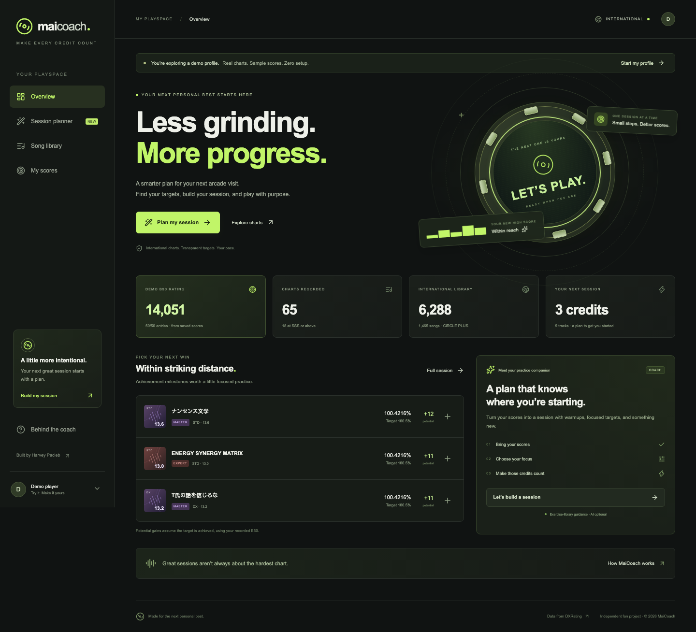

# MaiCoach

**Make every credit count.** A personal practice companion for maimai DX International, built by Harvey Pacleb with React, TypeScript, and LangChain.

MaiCoach turns recorded scores and a credit budget into a session of warmups, focused achievement targets, and discovery charts. The planner owns the numbers. Optional AI explains the session using a small, traceable exercise library.



## Try it

Live at **https://maicoach.harveypacleb.com**, with HTTPS and automatic certificate renewal.

No account is needed. The default demo uses real international charts with clearly labeled synthetic scores. Switch to **Start my profile** to record your own results. Demo scores never overwrite your personal profile.

## Features

- **International-only library:** 6,288 playable charts across 1,465 songs in the initial DXRating snapshot, selected for CiRCLE PLUS. International overrides take precedence over version-specific and base constants.
- **Session planner:** 1–12 credits, three tracks per credit, a constant range, a goal, and a self-selected practice focus. No duplicate chart identities within a plan.
- **B50 calculations:** best 35 old charts and 15 current-version charts; achievement boundary coefficients, integer arithmetic, AP bonus, and sequential replacement projections.
- **Score tracking:** local browser persistence, manual logging, validated JSON import/export, best-result merging, and a B50 breakdown.
- **Grounded coaching:** a LangChain prompt chain, retrieval of relevant exercise notes, and schema-validated model output. The computed plan stays read-only to the model.
- **Honest fallback:** a usable deterministic planner and exercise guidance when no provider is configured. The UI never describes this fallback as live AI.
- **Small VPS deployment:** prebuilt React assets and one Node process behind an isolated Nginx host; systemd memory limits and atomic release switching.

## Local development

Node 22+ is required; CI uses Node 24.

```bash
npm ci
npm run build
npm start
```

Open http://127.0.0.1:3107. For hot reload, use two terminals:

```bash
npm run dev
npm run dev:web
```

Vite proxies `/api` to the local Node service. A catalog snapshot is checked in, so starting the app requires no upstream API call.

## Enable AI coaching

Open **AI settings** in the header or **Add your API key** in the session planner. Choose OpenAI or a custom OpenAI-compatible provider, enter the API base URL, model ID, and key, then select **Use for this tab**. The default OpenAI model suggestion is `gpt-4o-mini`; use a model available to your account.

Keys stay in React memory for the current tab. Reloading, closing the tab, or choosing **Forget key** clears them from the app. Browser storage remembers only the endpoint, model, and output mode. Score/session exports never include credentials. Changing the endpoint clears the key field to avoid accidentally sending a key to a different provider.

The visitor's key is sent over HTTPS to MaiCoach's stateless relay only when coaching is requested, then used only with the selected endpoint. Keys, prompts, and upstream error objects are not persisted or logged by the application. No server API key or restart is required. Visitors pay their provider's usage charges.

**Standard chat** is the default compatibility mode: it calls `/chat/completions`, asks for JSON, and validates the result. It does not require `response_format`, tool calls, or the Responses API. **Strict JSON schema** is optional for providers/models that support it. The implementation follows [LangChain's custom-base-URL integration](https://docs.langchain.com/oss/javascript/integrations/chat/openai) and [OpenAI's structured-output interface](https://developers.openai.com/api/docs/guides/structured-outputs).

Custom providers must expose a public HTTPS endpoint on port 443. The relay rejects URL credentials/query parameters, loopback/private/link-local/reserved addresses, and mixed public/private DNS responses. It pins each fresh TLS connection to a checked address and does not follow redirects. Local Ollama/LM Studio endpoints are not reachable through this hosted relay. API base URLs typically end in `/v1`; a pasted `/chat/completions` suffix is normalized automatically.

The AI path is intentionally bounded:

1. Validate scores, international chart identities, and settings.
2. Compute chart selection, achievement targets, and sequential B50 deltas in TypeScript.
3. Retrieve exercise notes by the selected focus and session phases.
4. Pass a bounded plan summary, those sources, and the question to a LangChain prompt/model chain.
5. Parse structured `summary`, `tips`, and `answer` fields; display the retrieved sources.
6. Fall back visibly to exercise-library guidance on provider failure.

The model cannot change rating data or write scores. Scores and note counts cannot diagnose specific technique weaknesses. Prompt instructions and structured output reduce errors but cannot guarantee factual prose; check answers against the displayed sources.

AI requests have a per-IP limit of 10/hour, a concurrency cap of two, a five-second DNS deadline, a 25-second provider timeout, and bounded request/response sizes. There is no shared paid-inference budget because all AI calls use visitor-supplied keys. If using Cloudflare proxying, see the real-IP note in [deployment documentation](docs/deployment.md).

## Data and rating provenance

Data from [DXRating](https://dxrating.net), fetched from [its public catalog](https://miruku.dxrating.net/api/v1/dxdata). Each chart has a source link, and the app exposes the snapshot timestamp and SHA-256 checksum.

The international version and rating behavior were checked against [DXRating revision `8d82f8d`](https://github.com/gekichumai/dxrating/tree/8d82f8d997a5d31664c4cd0f0c9a7d86c809ebfc). Only sheets with `serverIds` containing `intl` are retained. Special/Utage charts are excluded. Constants resolve in this order: international override, selected-version value, base value. From CiRCLE onward, upstream's B15 pool includes the selected version and its immediate predecessor: CiRCLE PLUS therefore includes CiRCLE and CiRCLE PLUS. Available charts from a newer Japanese version also count in the recent international bucket, following upstream's current-region rule.

To refresh the snapshot:

```bash
npm run sync:data
```

Before changing release, verify DXRating's current international region version, then run:

```bash
DXRATING_INTL_VERSION='CiRCLE PLUS' npm run sync:data
npm test
npm run build
```

Refresh is explicit rather than a production cron. Failed fetches, invalid schemas, duplicate chart IDs, or implausibly small catalogs leave the previous snapshot intact. A refresh does not silently change the selected international release. `sourceCommit` records the revision used to verify the release/rating behavior, not the live catalog publication's Git revision.

## Score import

Use an exported MaiCoach file or an array in this format:

```json
{
  "region": "intl",
  "scores": [
    { "chartId": "dsht_REPLACE_ME", "achievement": 99.4321, "combo": "fc" }
  ]
}
```

Get a real chart ID from an export or the app's downloadable example. Achievement must be 0–101 with at most four decimal places. Bad JSON, another region, oversized files, and unknown international chart IDs reject the entire import. Existing profile results are merged by highest chart rating, with achievement as a tiebreaker. Native MaiCoach JSON is supported; arbitrary B50 screenshots and third-party export formats are not parsed in this version.

Scores stay in `localStorage`. Export before clearing browser data or moving devices. Planning sends scores to the stateless server; live AI additionally relays the visitor’s in-memory key, selected plan details, and question to their chosen provider. There is no server-side score database.

## Verification

```bash
npm test                  # Node tests: rating math, normalization, planner, imports, API
npm run build             # Strict TypeScript check + production builds
npx playwright install chromium
npm run test:e2e          # Desktop/mobile journeys and screenshots
npm audit
```

Tests cover B35/B15 limits, AP and boundary values, international overrides, Japan-only exclusion, exact sequential gain projections, malformed inputs, profile isolation, persistence, import failure, search, responsive layout, and truthful fallback mode. CI runs these checks on pushes and pull requests. BYOK tests run the real LangChain integration against deterministic SDK transport fixtures for standard and strict output, key/endpoint isolation, error redaction, and fallback. Browser tests verify custom settings, key forgetting, and exclusion from storage/exports. A live transport check with an intentionally invalid OpenAI key verifies the HTTPS connection receives a 401; paid inference is not exercised without a visitor’s own credentials.

See [the maintainer handoff](HANDOFF.md), [API contract](docs/api.yaml), [deployment guide](docs/deployment.md), and [third-party notices](THIRD_PARTY_NOTICES.md).

## Project layout

```text
src/              React UI and browser-local score storage
shared/           Types, validation, rating math, planner, exercise library
server/           Express API and LangChain coaching
scripts/          International catalog refresh
data/             Verified, normalized catalog snapshot
tests/            Unit/API tests and Playwright journeys
deploy/           Nginx host, systemd unit, atomic deployment script
docs/             API contract, operations, screenshots
```

MIT for MaiCoach code. Game content belongs to SEGA and its respective rights holders. This is an independent fan project, unaffiliated with SEGA or DXRating.
